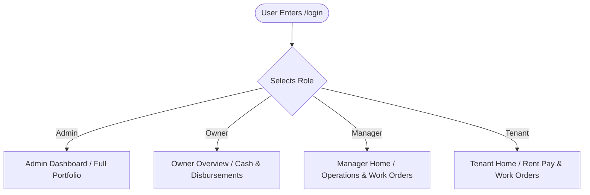
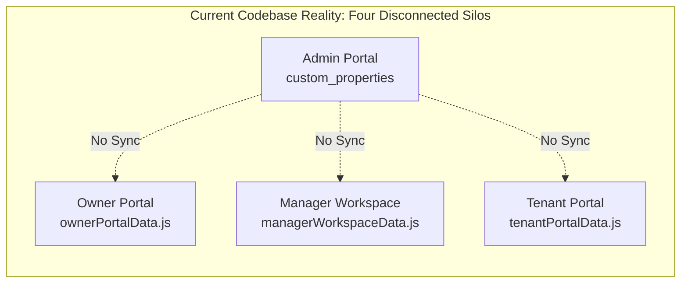
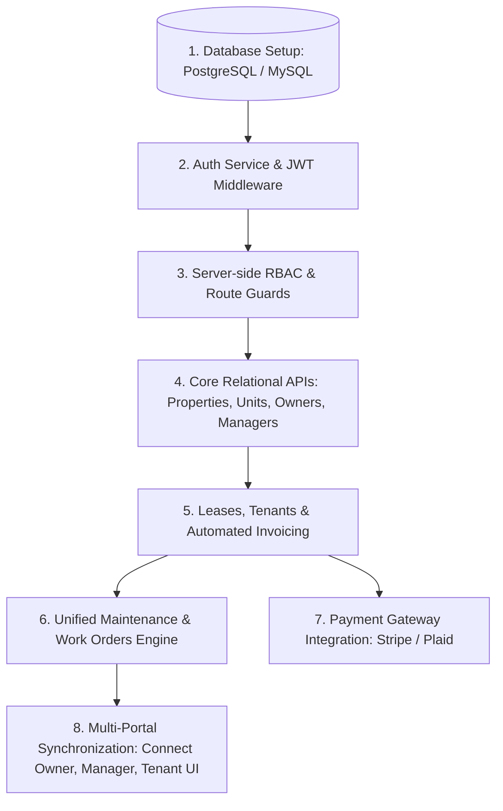
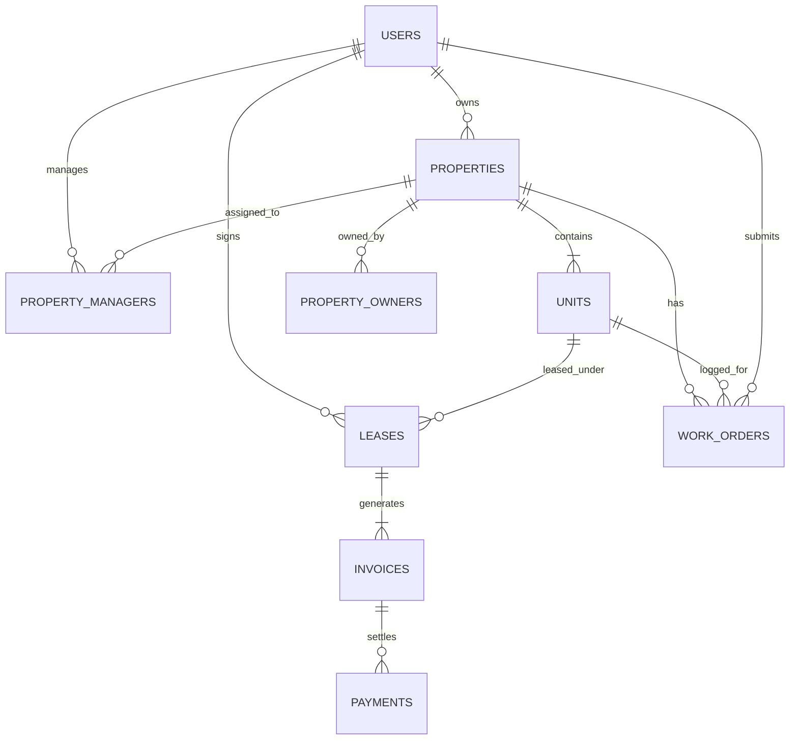

# Comprehensive Property Management Project Audit Report
**Target Platform:** RentLock / Ultimate Property Management Software  
**Audit Type:** UI, Architecture, Data Model, Security & Connectivity Audit  
**Date of Audit:** November 13, 2026  
**Auditor:** Antigravity AI Architecture Team  
**Scope:** Complete Codebase (`src/`, configuration files, data stores, layouts, and route trees)

---

## 1. Executive Summary

A comprehensive architectural, connectivity, and security audit was conducted on the **RentLock Property Management Platform**.

### Key Findings at a Glance:
1. **Frontend UI Maturity (~88% Complete):**  
   The application features a modern, responsive, and visually impressive user interface built with **React 19**, **Tailwind CSS v4**, and **Framer Motion**. It provides extensive screen implementations for four distinct personas: **Admin**, **Property Owner**, **Property Manager**, and **Tenant**, adhering closely to the provided design specifications and PDF wireframes.
2. **Backend & Server-Side Maturity (0% Complete):**  
   There is **no backend server**, **no REST/GraphQL API**, **no database engine (SQL or NoSQL)**, and **no server-side authentication**. The repository is strictly a static client-side Single Page Application (SPA).
3. **Data Architecture & The "Four Isolated Islands" Problem:**  
   The system does not maintain a unified state. Instead, it operates across **four completely disconnected data silos** stored in separate browser `localStorage` keys:
   - **Admin Workspace:** Reads and writes to `custom_properties`, `custom_units`, `custom_tenants`, `custom_leases`, `custom_invoices`, `custom_owners`, etc.
   - **Owner Portal:** Reads and writes exclusively to `rentlock_owner_portal_v1` (`ownerPortalData.js`).
   - **Manager Workspace:** Reads and writes exclusively to `rentlock_manager_workspace_v1` (`managerWorkspaceData.js`).
   - **Tenant Portal:** Reads and writes exclusively to `rentlock_tenant_portal_v1` (`tenantPortalData.js`).
   
   **Impact:** Actions taken in one portal do **not** propagate to other portals. For example, adding a property or tenant in the Admin portal does not appear in the Property Manager's workspace or the Tenant's payment portal.
4. **Connectivity & Relational Integrity (Broken/Simulated):**  
   The core entity chain **Admin → Owner → Manager → Tenant** exists only as cosmetic labels and hardcoded arrays in mock files. There are no relational constraints, no cascading triggers, and no foreign key enforcement.
5. **Security & Authorization (Critical Vulnerabilities):**  
   - There are **no role-based route guards**. Any authenticated user (e.g., a Tenant) can directly type `/settings`, `/owners`, or `/expenses` into the browser address bar and gain full visual and operational access to admin controls.
   - "Authentication" generates a client-side mock string (`mock-jwt-token-<timestamp>`) and stores plaintext user JSON in `localStorage.getItem('pm_user')`.

---

## 2. Existing Project Architecture

### 2.1 Technology Stack

| Layer | Technology | Version | Purpose |
| :--- | :--- | :--- | :--- |
| **Frontend Framework** | React | 19.2.5 | Component-based UI library |
| **Build Tool & Dev Server** | Vite | 8.0.9 | Bundler and rapid HMR development server |
| **Styling & CSS** | Tailwind CSS + `@tailwindcss/vite` | 4.2.3 | Utility-first responsive design system |
| **Routing** | React Router DOM | 7.14.1 | Client-side routing and layout nesting |
| **Icons** | Lucide React | 1.8.0 | Iconography across all navigation and dashboards |
| **Charts & Analytics** | Recharts | 3.8.1 | Area, Bar, and Pie visualization charts |
| **Animations** | Framer Motion | 12.38.0 | Micro-interactions, skyline animations, card transitions |
| **Notifications** | React Hot Toast | 2.6.0 | Toast alert messaging |
| **Date Utilities** | date-fns | 4.1.0 | Date formatting and calculation helpers |
| **Backend Framework** | **None** | — | **Missing** |
| **Database Engine** | **None** (Browser `localStorage`) | — | **Missing real DB** |
| **ORM / Query Builder** | **None** | — | **Missing** |
| **Authentication Provider**| **None** (Mock client service) | — | **Missing server JWT/OAuth** |

### 2.2 Project Structure Breakdown

```
d:\kiaan\property sonu sir\property\
├── dist/                          # Production build output
├── public/                        # Static assets (favicons, images)
├── src/
│   ├── assets/                    # SVG assets and styles
│   ├── components/                # Reusable UI component library
│   │   ├── charts/                # AreaChart, BarChart, PieChart wrappers
│   │   ├── manager/               # Manager scope bar & work order modal
│   │   ├── shared/                # PageHeader, StatCard, ErrorBoundary
│   │   └── ui/                    # Button, Input, Modal, Select, Table, Badge, Avatar, etc.
│   ├── context/                   # React Contexts (AuthContext, SidebarContext, SearchContext)
│   ├── data/                      # Mock datasets & localStorage storage managers
│   │   ├── adminPortalStore.js    # System settings, audit logs, connection health
│   │   ├── appDataReset.js        # Blank slate reset & demo seed engine
│   │   ├── managerWorkspaceData.js# Manager-specific isolated dataset
│   │   ├── mockExtra.js           # Owners, staff, expenses, complaints, reports
│   │   ├── mockInvoices.js        # Rent billing records
│   │   ├── mockLeases.js          # Lease agreements
│   │   ├── mockProperties.js      # Portfolio buildings and properties
│   │   ├── mockTenants.js         # Resident records
│   │   ├── mockUnits.js           # Unit listings
│   │   ├── mockUsers.js           # 4 predefined role user records
│   │   ├── ownerPortalData.js     # Owner-specific isolated dataset
│   │   ├── sidebarMenu.js         # Navigation items and role access filters
│   │   └── tenantPortalData.js    # Tenant-specific isolated dataset
│   ├── layouts/                   # Layout wrappers (MainLayout, AuthLayout, Navbar, Sidebar)
│   ├── pages/                     # 49 UI View Pages
│   │   ├── auth/                  # Login, ForgotPassword, ResetPassword
│   │   ├── billing/               # RentAndPayments, Invoices, Receipts, Ledger, Deposits
│   │   ├── dashboard/             # Role-aware Master Dashboard
│   │   ├── expenses/              # ExpenseList, AddExpense
│   │   ├── leases/                # LeaseList, CreateLease, LeaseDetail
│   │   ├── maintenance/           # ComplaintBoard (Work Orders Kanban)
│   │   ├── manager/               # Manager Workspace (7 subpages)
│   │   ├── owner/                 # Owner Portal (5 subpages)
│   │   ├── owners/                # Admin Owner Directory & Detail
│   │   ├── properties/            # PropertyList, AddProperty, PropertyDetail
│   │   ├── reports/               # ReportsDashboard (16 interactive reports)
│   │   ├── settings/              # SettingsPage (Company, Policies, RBAC, Backups, Health)
│   │   ├── tenant/                # Tenant Portal (4 subpages)
│   │   ├── tenants/               # TenantList, AddTenant, TenantProfile
│   │   └── units/                 # UnitList, AddUnit, UnitDetail
│   ├── routes/
│   │   └── AppRoutes.jsx          # Central Route Definitions (153 lines)
│   ├── services/
│   │   └── api.js                 # Simulated in-memory CRUD & delay service
│   ├── utils/                     # Validators, Formatters, SearchUtils, Constants
│   ├── App.jsx                    # Root App component with ErrorBoundary & Contexts
│   └── main.jsx                   # React 19 bootstrap entry
├── package.json                   # Dependencies and scripts
└── vite.config.js                 # Vite configuration
```

---

## 3. Frontend Audit

### 3.1 Page Inventory & Implementation Status

| Module | Route | Component File | Current Implementation | Data Source |
| :--- | :--- | :--- | :--- | :--- |
| **Auth** | `/login` | `Login.jsx` | Skyline animation, role selector, credentials form | `authService.login` (`api.js`) |
| **Auth** | `/forgot-password` | `ForgotPassword.jsx` | Simulated email link dispatch | Local Component State |
| **Auth** | `/reset-password` | `ResetPassword.jsx` | Password reset inputs | Local Component State |
| **Dashboard** | `/dashboard` | `Dashboard.jsx` | Switches view based on `user.role` (Admin/Owner/Manager/Tenant) | `getProperties()`, `getInvoices()` |
| **Properties**| `/properties` | `PropertyList.jsx` | KPI cards, search, property grid, archive/delete | `getProperties()` (`mockProperties.js`) |
| **Properties**| `/properties/add` | `AddProperty.jsx` | 4-step wizard: Basic, Ownership, Units, Financials | `addProperty()`, `addUnit()` |
| **Properties**| `/properties/:id` | `PropertyDetail.jsx` | Detail header, units table, leases tab, financials | `getProperties().find()` |
| **Units** | `/units` | `UnitList.jsx` | Filterable unit directory by occupancy & property | `getUnits()` (`mockUnits.js`) |
| **Units** | `/units/add` | `AddUnit.jsx` | Single unit creation form | `addUnit()` (`mockUnits.js`) |
| **Units** | `/units/:id` | `UnitDetail.jsx` | Unit occupancy, lease history, rent amount | `getUnits().find()` |
| **Tenants** | `/tenants` | `TenantList.jsx` | Resident list with rent status badges | `getTenants()` (`mockTenants.js`) |
| **Tenants** | `/tenants/add` | `AddTenant.jsx` | Tenant onboarding form with unit assignment | `addTenant()` (`mockTenants.js`) |
| **Tenants** | `/tenants/:id` | `TenantProfile.jsx`| Resident contact, lease agreement, payment log | `getTenants().find()` |
| **Owners** | `/owners` | `OwnerList.jsx` | Directory, KPIs, Add Owner Modal with Password, CSV | `getOwners()`, `addOwner()`, `updateOwner()` |
| **Owners** | `/owners/:id` | `OwnerDetail.jsx` | Equity shares, payout history, account credentials | `getOwners().find()` |
| **Leases** | `/leases` | `LeaseList.jsx` | Leases by status (Active, Expiring, Pending E-Sign) | `getLeases()` (`mockLeases.js`) |
| **Leases** | `/leases/create` | `CreateLease.jsx` | Lease agreement generator with clause builder | `addLease()` (`mockLeases.js`) |
| **Leases** | `/leases/:id` | `LeaseDetail.jsx` | Terms, e-sign status, mock PDF agreement download | `getLeases().find()` |
| **Billing** | `/rent-payments` | `RentAndPayments.jsx`| Tabbed: Invoices, Receipts, Ledger, Collections | `getInvoices()` (`mockInvoices.js`) |
| **Maintenance**| `/maintenance` | `ComplaintBoard.jsx`| Kanban work order queue, vendor dispatching | `mockComplaints` (`mockExtra.js`) |
| **Expenses** | `/expenses` | `ExpenseList.jsx` | Operating & CapEx bills, 1099 tracking | `getExpenses()` (`mockExpenses.js`) |
| **Expenses** | `/expenses/add` | `AddExpense.jsx` | Multi-property bill allocation form | `addExpense()` (`mockExpenses.js`) |
| **Reports** | `/reports` | `ReportsDashboard.jsx`| 16 reports with live tables & browser CSV export | In-memory calculation from mock data |
| **Settings** | `/settings` | `SettingsPage.jsx` | Company, Policies, RBAC matrix, Reset/Seed, Health | `adminPortalStore.js` |
| **Owner** | `/owner/income-out`| `OwnerIncomeOut.jsx` | Cash in vs cash out statement | `ownerPortalData.js` (Isolated) |
| **Owner** | `/owner/expenses` | `OwnerExpenses.jsx` | Detailed maintenance bills and vendor deductions | `ownerPortalData.js` (Isolated) |
| **Owner** | `/owner/disbursements`| `OwnerDisbursements.jsx`| Historical payouts, payout formula breakdown | `ownerPortalData.js` (Isolated) |
| **Owner** | `/owner/records` | `OwnerRecords.jsx` | Downloadable legal & tax records archive | `ownerPortalData.js` (Isolated) |
| **Manager** | `/manager/properties`| `ManagerProperties.jsx`| Assigned property cards and status | `managerWorkspaceData.js` (Isolated) |
| **Manager** | `/manager/tenants` | `ManagerTenants.jsx` | Assigned building residents & contact info | `managerWorkspaceData.js` (Isolated) |
| **Manager** | `/manager/work-orders`| `ManagerWorkOrders.jsx`| Work order review, dispatch, $1000 limit approval | `managerWorkspaceData.js` (Isolated) |
| **Manager** | `/manager/messages`| `ManagerMessages.jsx`| In-app chat threads with tenants & vendors | `managerWorkspaceData.js` (Isolated) |
| **Manager** | `/manager/schedule`| `ManagerSchedule.jsx`| Calendar of move-ins, inspections, repairs | `managerWorkspaceData.js` (Isolated) |
| **Manager** | `/manager/reports` | `ManagerReports.jsx` | Manager operational metrics & occupancy | `managerWorkspaceData.js` (Isolated) |
| **Tenant** | `/tenant/pay` | `TenantPay.jsx` | Online rent payment, payment history | `tenantPortalData.js` (Isolated) |
| **Tenant** | `/tenant/work-order`| `TenantWorkOrder.jsx` | Submit repair request with photo mock | `tenantPortalData.js` (Isolated) |
| **Tenant** | `/tenant/messages` | `TenantMessages.jsx` | Resident chat thread with property manager | `tenantPortalData.js` (Isolated) |

### 3.2 Frontend Deficiencies & UI Gaps
1. **Forms Without Backend Processing:** All forms (`AddProperty`, `AddTenant`, `CreateLease`, `AddExpense`, `TenantPay`, `TenantWorkOrder`) perform purely local state array pushes. No network payloads are transmitted.
2. **Missing Real File Uploads:** Upload components (`FileUpload.jsx`) read local file metadata (`file.name`, `file.size`) or convert to client Base64 strings. No cloud storage (AWS S3, Google Cloud Storage) or multipart upload pipelines exist.
3. **No Loading or Network Error States:** Because data is read synchronously from memory or `localStorage`, pages lack skeleton loaders, network failure banners, retry buttons, and pagination controls.
4. **No Self-Service Profile Page:** Clicking "My Profile" in the top navigation bar routes to `/dashboard` instead of an actual user profile or security preferences page.

---

## 4. Backend Audit

### 4.1 Server & API Architecture
- **Server Framework:** **None**. There is no Node.js, Express, NestJS, Python (FastAPI/Django), or Go backend server in this repository.
- **REST Endpoints:** **0**. No HTTP routes exist.
- **WebSocket / Real-time:** **0**. Messaging screens (`ManagerMessages.jsx`, `TenantMessages.jsx`) simulate message sending by appending objects to local arrays. No Socket.io or WebSocket server exists.
- **Simulated Service Layer:** Located in `src/services/api.js`. It wraps mock arrays inside promises using `setTimeout(resolve, 200)`.

```javascript
// Current Simulated API Service in src/services/api.js
const createService = (getter, fallback) => ({
  getAll: async () => {
    await delay();
    return typeof getter === 'function' ? getter() : [...(getter || fallback || [])];
  },
  getById: async (id) => {
    await delay();
    const list = typeof getter === 'function' ? getter() : (getter || fallback || []);
    return list.find(item => item.id === id || item.id === String(id));
  },
  create: async (newItem) => { await delay(); return { ...newItem, id: Date.now() }; },
  update: async (id, updates) => {
    await delay();
    const list = typeof getter === 'function' ? getter() : (getter || fallback || []);
    return { ...list.find(item => item.id === id), ...updates };
  },
  delete: async (id) => { await delay(); return { success: true, id }; },
});
```

### 4.2 Missing Backend Services
- **Authentication Service:** Password hashing (bcrypt/argon2), JWT issuance, refresh token rotation, session invalidation.
- **Payment Processing Service:** Webhook handlers for Stripe, Plaid ACH, or Razorpay.
- **Notification & Communication Service:** SMTP/SendGrid email delivery, Twilio SMS alerts.
- **Background Job Engine:** Daily late-fee calculation cron, lease expiration notification cron, automated monthly invoice generation.
- **File Management Service:** Secure pre-signed URL generation, virus scanning, CDN distribution.

---

## 5. Database Audit

### 5.1 Current Data Persistence Mechanism
Data is stored directly in browser **`window.localStorage`**. If a user clears their browser cache, uses an incognito window, or switches devices, **all created properties, tenants, owners, and invoices are permanently lost**.

```
Browser LocalStorage
├── custom_properties              # Array of Property objects
├── custom_units                   # Array of Unit objects
├── custom_tenants                 # Array of Tenant objects
├── custom_leases                  # Array of Lease objects
├── custom_invoices                # Array of Invoice objects
├── custom_owners                  # Array of Owner entities
├── custom_expenses_us             # Array of Expense bills
├── custom_work_orders_us          # Array of Maintenance complaints
├── rentlock_owner_portal_v1       # Isolated Owner Portal state
├── rentlock_manager_workspace_v1  # Isolated Manager Workspace state
├── rentlock_tenant_portal_v1      # Isolated Tenant Portal state
├── rentlock_admin_portal_state_v1 # Admin RBAC and settings
├── pm_user                        # Current logged-in user JSON
└── pm_token                       # Client-generated mock token string
```

### 5.2 Critical Data Model Issues
1. **No Foreign Key Enforcement:** Properties store owner names as unstructured strings (e.g. `'Robert King (60%), Claire Bennett (40%)'`) rather than normalized ID foreign keys.
2. **Orphaned Record Vulnerability:** Deleting a property does not delete or reassign its linked units, leases, tenants, or invoices.
3. **Data Redundancy:** Tenant records redundantly duplicate property name, unit number, rent amount, and owner info.
4. **Storage Quota Limitations:** LocalStorage has a strict 5MB–10MB limit per origin. Uploading a few Base64 documents or inspection photos will trigger `QuotaExceededError`.

---

## 6. User Roles & Permissions Audit

The application defines four user roles across `src/data/mockUsers.js` and `src/layouts/Sidebar.jsx`.



### Role Functionality & Gap Matrix

| Capability | Admin | Owner | Manager | Tenant | Status / Gap |
| :--- | :---: | :---: | :---: | :---: | :--- |
| **Self-Registration** | ❌ No | ❌ No | ❌ No | ❌ No | **No public signup flow exists for any role.** |
| **Login via Credentials** |  Yes |  Yes |  Yes |  Yes | Works via `authService.login` with mock tokens. |
| **Password Setup by Admin**| ❌ No |  Yes | ❌ No | ❌ No | Only Owner currently has admin-set password field. |
| **Create Properties** |  Yes | ❌ No | ❌ No | ❌ No | Owners cannot add their own properties. |
| **Assign Manager to Property**|  Yes | ❌ No | ❌ No | ❌ No | Hardcoded manager select dropdown in Admin form. |
| **Add / Invite Tenants** |  Yes | ❌ No | ⚠️ Partial | ❌ No | Manager creates in isolated silo; Admin in another. |
| **Create Leases** |  Yes | ❌ No | ❌ No | ❌ No | Only Admin can execute lease builder. |
| **Pay Rent Online** | ❌ N/A | ❌ N/A | ❌ N/A | ⚠️ Mock | Tenant sees payment UI, but no gateway connected. |
| **Submit Maintenance Request**|  Yes | ❌ No |  Yes |  Yes | Three separate complaint boards with no sync! |
| **Approve Maintenance > $1000**|  Yes | ❌ No | ❌ Capped | ❌ No | Visual spending cap rule in UI; not backend enforced. |
| **Inspect Financial Ledgers** |  Yes |  Yes | ❌ No | ❌ No | Owner sees cash waterfall; Admin sees full P&L. |
| **Configure System Policies** |  Yes | ❌ No | ❌ No | ❌ No | Admin Settings controls late fees & RBAC. |
| **Strict Route Guarding** | ❌ No | ❌ No | ❌ No | ❌ No | **Zero route protection. Any role can access any URL.** |

---

## 7. Owner-Manager-Tenant Connectivity Audit

This section evaluates the end-to-end relational chain: **Admin → Owner → Manager → Tenant**.



### Detailed Evaluation of the 9 Connectivity Requirements

#### 1. Can an Owner register and create properties?
- **Registration:** **No**. There is no registration page for owners. Owners are created manually by Admin in `/owners`.
- **Create Properties:** **No**. When an owner logs in, their sidebar contains only: *Overview, Income & Out, Expenses, Disbursements, Records*. There is no "+ Add Property" button in the Owner Portal. Properties can only be created by the Administrator.

#### 2. Can an Owner assign a Manager?
- **Finding:** **No**. The Owner Portal provides zero manager management features. Manager assignment is exclusively an Admin action on `/properties/add` or `/properties/:id`.

#### 3. Can a Manager manage assigned properties?
- **Finding:** **Partially (Simulated Only)**.
- **Details:** The Manager Workspace (`/manager/properties`) displays 4 buildings (`Sunrise Residency`, `Metro Business Park`, `Green Valley Villas`, `Orchid Society`). However, these are hardcoded in `managerWorkspaceData.js`. If an Admin creates a new property and assigns it to "Sarah Jenkins", it **does not appear** in the Manager Workspace.

#### 4. Can a Manager add/invite Tenants?
- **Finding:** **Partially (Broken Relay)**.
- **Details:** The Manager has an "+ Add Resident" modal in `ManagerTenants.jsx`. However, this saves only to `managerWorkspaceData.js`. It does not notify the tenant, does not generate a tenant portal login, and does not record the tenant in the Admin's central `custom_tenants` directory.

#### 5. Can Tenants access their assigned/rented properties?
- **Finding:** **Partially (Hardcoded Mock)**.
- **Details:** The Tenant Portal (`TenantHome.jsx`, `TenantPay.jsx`) is hardcoded to display Unit `A-204` at `Sunrise Residency`. When an Admin creates a lease for a new tenant on another property, that tenant cannot log in and see their actual unit.

#### 6. Can Owners view their Managers and Tenants?
- **Finding:** **No**.
- **Details:** In `OwnerOverview.jsx`, `OwnerExpenses.jsx`, and `OwnerIncomeOut.jsx`, tenant names and personal identifiers are explicitly redacted per mock privacy notes (*"Tenant PII excluded per privacy policy"*). The owner sees total aggregate rent collected, but cannot inspect who the tenants or assigned on-site staff are.

#### 7. Can Managers access only their assigned properties?
- **Finding:** **Frontend Filter Only; Backend Security 0%**.
- **Details:** The manager UI limits visible buildings using `managerWorkspaceData.js`. However, there is no server-side token scoping. A manager can navigate directly to `/properties` or `/expenses` and inspect properties across the entire portfolio.

#### 8. Can Tenants access only their own rental information?
- **Finding:** **Frontend Hardcoded Only**.
- **Details:** The tenant portal only renders Unit A-204 because `tenantPortalData.js` contains only Rebecca Miller's record. However, if a tenant types `/dashboard` or `/tenants` into the URL bar, they can view all residents and portfolio data.

#### 9. Are all relationships properly maintained in the database?
- **Finding:** **No**. There is no database. Data is stored in disconnected browser storage keys with zero referential integrity.

---

## 8. API & Backend Connectivity Audit

| Functional Area | Frontend Route | Connected API Endpoints | Missing API Endpoints Needed | Data Source Type |
| :--- | :--- | :--- | :--- | :--- |
| **Authentication** | `/login` | Simulated `authService.login` | `POST /api/v1/auth/login`<br>`POST /api/v1/auth/refresh`<br>`POST /api/v1/auth/logout` | Mock in `api.js` |
| **Properties** | `/properties` | Simulated `propertyService.getAll` | `GET /api/v1/properties`<br>`POST /api/v1/properties`<br>`DELETE /api/v1/properties/:id` | `localStorage` |
| **Units** | `/units` | Simulated `unitService.getAll` | `GET /api/v1/units`<br>`POST /api/v1/units`<br>`PUT /api/v1/units/:id` | `localStorage` |
| **Tenants** | `/tenants` | Simulated `tenantService.getAll` | `GET /api/v1/tenants`<br>`POST /api/v1/tenants`<br>`POST /api/v1/tenants/invite` | `localStorage` |
| **Owners** | `/owners` | Simulated `ownerService.getAll` | `GET /api/v1/owners`<br>`POST /api/v1/owners`<br>`PUT /api/v1/owners/:id` | `localStorage` |
| **Leases** | `/leases` | Simulated `leaseService.getAll` | `GET /api/v1/leases`<br>`POST /api/v1/leases`<br>`POST /api/v1/leases/:id/sign` | `localStorage` |
| **Rent & Billing** | `/rent-payments` | Simulated `invoiceService.getAll` | `GET /api/v1/invoices`<br>`POST /api/v1/invoices`<br>`POST /api/v1/payments/record` | `localStorage` |
| **Expenses** | `/expenses` | Simulated `expenseService.getAll` | `GET /api/v1/expenses`<br>`POST /api/v1/expenses`<br>`PUT /api/v1/expenses/:id/approve` | `localStorage` |
| **Maintenance** | `/maintenance` | Simulated `complaintService.getAll` | `GET /api/v1/work-orders`<br>`POST /api/v1/work-orders`<br>`PATCH /api/v1/work-orders/:id/status`| Mock Array |
| **Tenant Payment** | `/tenant/pay` | None | `GET /api/v1/tenant/balance`<br>`POST /api/v1/payments/checkout-session`<br>`POST /api/v1/payments/verify` | `tenantPortalData.js` |
| **Manager Orders** | `/manager/work-orders`| None | `GET /api/v1/manager/work-orders`<br>`POST /api/v1/manager/work-orders/:id/dispatch` | `managerWorkspaceData.js` |
| **Owner Ledger** | `/owner/income-out` | None | `GET /api/v1/owner/ledger`<br>`GET /api/v1/owner/disbursements` | `ownerPortalData.js` |

---

## 9. Complete User Workflow Audit

### Workflow A: Property Owner
```
[Step 1] Registration          ❌ FAILED: No owner registration page exists.
[Step 2] Login                 ⚠️ PARTIAL: Works only if Admin created Owner first in /owners.
[Step 3] Create Property       ❌ FAILED: Owner portal has no property creation interface.
[Step 4] Add Property Details  ❌ FAILED: Cannot edit or configure buildings.
[Step 5] Assign Manager        ❌ FAILED: No manager assignment feature for owners.
[Step 6] View Property         ⚠️ PARTIAL: Shows cash totals for 3 hardcoded properties in ownerPortalData.js.
[Step 7] Manage Tenants        ❌ FAILED: Tenant lists and contact info are hidden from owners.
```
*Overall Workflow A Status: 15% Functional*

---

### Workflow B: Property Manager
```
[Step 1] Registration / Invite ❌ FAILED: No manager registration or invite acceptance flow.
[Step 2] Login                  Yes: Works with hardcoded demo credentials (sarah.jenkins@rentlock.com).
[Step 3] Accept Assignment     ❌ FAILED: No invitation or property assignment acceptance mechanism.
[Step 4] View Assigned Props   ⚠️ PARTIAL: Renders 4 properties from managerWorkspaceData.js; disconnected from Admin.
[Step 5] Manage Property       ⚠️ PARTIAL: Can update occupancy & notes inside managerWorkspaceData.js only.
[Step 6] Add / Invite Tenant   ⚠️ PARTIAL: Can fill "+ Add Resident" modal, but saves only to local manager array.
[Step 7] Manage Tenant Records ⚠️ PARTIAL: Local list view only; no real communication or lease binding.
```
*Overall Workflow B Status: 35% Functional*

---

### Workflow C: Tenant
```
[Step 1] Invitation / Register ❌ FAILED: No tenant signup or onboarding link acceptance flow.
[Step 2] Login                  Yes: Works with hardcoded demo credentials (rebecca@rentlock.com).
[Step 3] Accept Assignment     ❌ FAILED: Unit A-204 is permanently pre-assigned in static mock data.
[Step 4] View Rental Details    Yes: Displays rent amount ($2,000), due date, and lease term.
[Step 5] Pay Rent Online       ⚠️ PARTIAL: Form accepts card inputs and shows success toast, but no real money moves.
[Step 6] Submit Work Order     ⚠️ PARTIAL: Submits ticket into tenantPortalData.js; never reaches Admin or Manager.
[Step 7] Manage Profile        ❌ FAILED: Clicking "My Profile" redirects to dashboard.
```
*Overall Workflow C Status: 40% Functional*

---

### Workflow D: Administrator
```
[Step 1] Login                  Yes: Full access using admin@rentlock.com / demo123.
[Step 2] View All Users        ⚠️ PARTIAL: Can view Owners (/owners) and Tenants (/tenants); Manager list missing.
[Step 3] Manage Owners          Yes: Full CRUD on /owners with custom password setting and CSV export.
[Step 4] Manage Managers       ❌ FAILED: No /managers page exists. Managers are hardcoded in a dropdown.
[Step 5] Manage Tenants         Yes: Can add, view, and inspect tenants in /tenants.
[Step 6] Manage Properties      Yes: 4-step property creation wizard persists to localStorage.
[Step 7] Monitor Platform       Yes: Comprehensive Dashboard, Reports (16 categories), and Settings RBAC.
```
*Overall Workflow D Status: 75% Functional*

---

## 10. Security & Data Isolation Audit

### 10.1 Vulnerability Assessment Matrix

| Threat Category | Severity | Current Status in Codebase | Risk & Exploitation Vector |
| :--- | :---: | :--- | :--- |
| **Missing Route Authorization** | **CRITICAL** | `MainLayout.jsx` only checks `if (!isAuthenticated)`. No role checks on routes. | A logged-in Tenant can navigate to `/settings`, `/owners`, `/expenses`, and `/reports` directly via URL bar. |
| **Broken Data Isolation (IDOR)** | **CRITICAL** | All queries in `api.js` and pages read entire array from `localStorage`. | Any user has access to all records in the browser. No tenant- or manager-scoped token verification. |
| **Client-Side Authentication** | **HIGH** | `authService.login` stores user profile & mock JWT in plaintext `localStorage`. | Modifying `localStorage.setItem('pm_user', JSON.stringify({ role: 'admin' }))` instantly grants admin privileges. |
| **Plaintext Password Storage** | **HIGH** | Owner passwords are saved unhashed in `localStorage.custom_owners`. | Anyone with access to the browser console can inspect plaintext passwords. |
| **No Backend Input Validation** | **HIGH** | Validation is handled exclusively via client JS `.trim()`. | Direct API exploitation without sanitization will cause injection and database corruption. |
| **Sensitive Data Exposure** | **MEDIUM** | Entire portfolio financials, vendor bills, and tenant lists reside in browser storage. | Any malicious browser extension or XSS script can dump all portfolio records. |

---

## 11. Missing Features

### 11.1 Critical Missing Core Modules
1. **Manager Management Section (`/managers`):**  
   There is currently no screen or table where the Admin can view, create, edit, deactivate, or assign Property Managers. Managers exist only as static names (`Sarah Jenkins`, `David Brooks`, `Elena Rostova`).
2. **Public Self-Service Registration:**  
   No signup pages exist for Owners, Managers, or Tenants.
3. **Automated Tenant Onboarding / Invitation Engine:**  
   When a lease is created, the system does not email an activation token or setup link to the tenant.
4. **Live Payment Gateway:**  
   No Stripe, Plaid, or payment processor integration for credit card, debit card, or ACH payments.
5. **Real-time Push & Messaging Backend:**  
   No WebSocket or real-time event infrastructure for chats, work order updates, or rent alerts.
6. **Persistent Audit Log:**  
   Audit logs currently live in `localStorage` under `rentlock_admin_portal_state_v1` and are wiped if storage is cleared.

---

## 12. Critical Bugs & Technical Blockers

```
┌──────────┬──────────────────────┬──────────┬─────────────────────────────────────────────────────────────┐
│ Issue ID │ Module               │ Priority │ Summary Description                                         │
├──────────┼──────────────────────┼──────────┼─────────────────────────────────────────────────────────────┤
│ AUD-001  │ Architecture         │ CRITICAL │ Complete absence of backend server and API layer            │
│ AUD-002  │ Database             │ CRITICAL │ Zero persistent database; system relies on browser storage  │
│ AUD-003  │ Synchronization      │ CRITICAL │ 4 isolated data silos (Admin, Owner, Manager, Tenant)       │
│ AUD-004  │ Security / RBAC      │ CRITICAL │ Missing route guards; any role can open any URL route       │
│ AUD-005  │ Security / Auth      │ CRITICAL │ Client-side privilege spoofing via localStorage             │
│ AUD-006  │ Team / Staff         │ HIGH     │ Missing Manager directory and Manager creation module       │
│ AUD-007  │ Onboarding           │ HIGH     │ Zero public signup or invitation token acceptance flow      │
│ AUD-008  │ Maintenance          │ HIGH     │ 3 separate work order queues with no communication          │
│ AUD-009  │ Billing / Payments   │ HIGH     │ No real payment gateway or bank verification                │
│ AUD-010  │ File Storage         │ HIGH     │ No cloud file storage (S3/GCS); quota limit risk            │
│ AUD-011  │ Navigation           │ MEDIUM   │ "My Profile" button routes to /dashboard                    │
│ AUD-012  │ Data Integrity       │ MEDIUM   │ Unrestricted deletion without referential cascading checks  │
│ AUD-013  │ User Security        │ MEDIUM   │ Plaintext password storage for dynamic owners               │
│ AUD-014  │ Real-time Messaging  │ MEDIUM   │ Message threads are client-only mock arrays                 │
└──────────┴──────────────────────┴──────────┴─────────────────────────────────────────────────────────────┘
```

---

## 13. Dependency Mapping

Before implementing any backend or connectivity code, tasks must follow this strict dependency hierarchy:



1. **Step 1: Database Architecture Setup** must precede API development.
2. **Step 2: Server-side Authentication & JWT Engine** must precede User Management.
3. **Step 3: Server-side RBAC** must precede Portal Connectivity.
4. **Step 4: Unified Property & Unit APIs** must precede Owner and Manager workspaces.
5. **Step 5: Unified Lease & Tenant APIs** must precede Tenant payment portal.
6. **Step 6: Payment Processor Webhook Infrastructure** must precede Live Billing.

---

## 14. Recommended Database Relationships (Production Schema)

To transform this frontend prototype into a production-ready system, the following relational database schema is recommended:



### Relational Table Definitions

#### 1. `users` Table
- `id` (UUID, Primary Key)
- `email` (VARCHAR(255), Unique, Indexed)
- `password_hash` (VARCHAR(255), Not Null)
- `full_name` (VARCHAR(150), Not Null)
- `phone` (VARCHAR(30))
- `role` (ENUM: `'super_admin'`, `'admin'`, `'owner'`, `'manager'`, `'tenant'`)
- `status` (ENUM: `'active'`, `'pending_invite'`, `'suspended'`)
- `avatar_url` (VARCHAR(500))
- `created_at`, `updated_at` (TIMESTAMP)

#### 2. `properties` Table
- `id` (UUID, Primary Key)
- `name` (VARCHAR(200), Not Null)
- `code` (VARCHAR(50), Unique)
- `property_type` (ENUM: `'residential'`, `'commercial'`, `'industrial'`, `'mixed_use'`)
- `address_street`, `city`, `state`, `zip`, `country` (VARCHAR)
- `total_floors` (INT)
- `created_by_user_id` (UUID, FK -> `users.id`)
- `created_at`, `updated_at` (TIMESTAMP)

#### 3. `property_owners` (Many-to-Many Bridge Table)
- `property_id` (UUID, FK -> `properties.id`, On Delete Cascade)
- `owner_user_id` (UUID, FK -> `users.id`, On Delete Restrict)
- `equity_share_percentage` (DECIMAL(5,2), Check: `> 0 AND <= 100`)
- Primary Key (`property_id`, `owner_user_id`)

#### 4. `property_managers` (Assignment Bridge Table)
- `property_id` (UUID, FK -> `properties.id`, On Delete Cascade)
- `manager_user_id` (UUID, FK -> `users.id`, On Delete Restrict)
- `spending_approval_cap` (DECIMAL(10,2), Default: 1000.00)
- `assigned_at` (TIMESTAMP)
- Primary Key (`property_id`, `manager_user_id`)

#### 5. `units` Table
- `id` (UUID, Primary Key)
- `property_id` (UUID, FK -> `properties.id`, On Delete Cascade)
- `unit_number` (VARCHAR(50), Not Null)
- `floor_number` (INT)
- `bedrooms`, `bathrooms` (DECIMAL(3,1))
- `square_feet` (INT)
- `monthly_base_rent` (DECIMAL(10,2), Not Null)
- `occupancy_status` (ENUM: `'vacant'`, `'occupied'`, `'maintenance'`)
- Unique Key (`property_id`, `unit_number`)

#### 6. `leases` Table
- `id` (UUID, Primary Key)
- `lease_number` (VARCHAR(50), Unique)
- `unit_id` (UUID, FK -> `units.id`, On Delete Restrict)
- `tenant_user_id` (UUID, FK -> `users.id`, On Delete Restrict)
- `start_date`, `end_date` (DATE, Not Null)
- `monthly_rent` (DECIMAL(10,2), Not Null)
- `security_deposit` (DECIMAL(10,2), Not Null)
- `lease_status` (ENUM: `'draft'`, `'pending_signature'`, `'active'`, `'expired'`, `'terminated'`)
- `document_url` (VARCHAR(500))

#### 7. `invoices` Table
- `id` (UUID, Primary Key)
- `invoice_number` (VARCHAR(50), Unique)
- `lease_id` (UUID, FK -> `leases.id`, On Delete Restrict)
- `tenant_user_id` (UUID, FK -> `users.id`)
- `due_date` (DATE, Not Null)
- `amount_due` (DECIMAL(10,2), Not Null)
- `amount_paid` (DECIMAL(10,2), Default: 0.00)
- `payment_status` (ENUM: `'unpaid'`, `'partial'`, `'paid'`, `'overdue'`)
- `created_at` (TIMESTAMP)

#### 8. `payments` Table
- `id` (UUID, Primary Key)
- `invoice_id` (UUID, FK -> `invoices.id`, On Delete Restrict)
- `transaction_reference` (VARCHAR(100), Unique)
- `payment_method` (ENUM: `'ach'`, `'credit_card'`, `'debit_card'`, `'check'`, `'cash'`)
- `amount` (DECIMAL(10,2), Not Null)
- `payment_date` (TIMESTAMP, Not Null)
- `processor_response_payload` (JSONB)

#### 9. `work_orders` (Maintenance Requests)
- `id` (UUID, Primary Key)
- `ticket_number` (VARCHAR(50), Unique)
- `property_id` (UUID, FK -> `properties.id`)
- `unit_id` (UUID, FK -> `units.id`, Nullable for Common Areas)
- `reported_by_user_id` (UUID, FK -> `users.id`)
- `assigned_to_user_id` (UUID, FK -> `users.id`, Nullable)
- `title` (VARCHAR(200), Not Null)
- `description` (TEXT)
- `priority` (ENUM: `'low'`, `'normal'`, `'high'`, `'urgent'`)
- `status` (ENUM: `'new'`, `'reviewed'`, `'in_progress'`, `'completed'`, `'closed'`)
- `estimated_cost` (DECIMAL(10,2))
- `actual_cost` (DECIMAL(10,2))
- `photos` (JSONB Array of URLs)
- `created_at`, `updated_at` (TIMESTAMP)

---

## 15. Overall Project Completion Assessment

```
┌──────────────────────────────────────────────┬────────────┬────────────────────────────────────────────────────────┐
│ Project Component                            │ Completion │ Status                                                 │
├──────────────────────────────────────────────┼────────────┼────────────────────────────────────────────────────────┤
│ UI Design & Visual Polish                    │    92%     │ Excellent: Clean Tailwind layouts, animations & icons  │
│ Page Layouts & Component Modularity          │    88%     │ High: 49 pages implemented across all 4 personas       │
│ Navigation & Role Layout Menus               │    80%     │ Good: Sidebar filters by role; top navbar responsive   │
│ Client-Side Form Interactivity               │    68%     │ Moderate: Local state updates, basic toast messages    │
│ Multi-Portal Relational Synchronization      │    12%     │ Critical Deficit: 4 separate isolated mock silos       │
│ Security & Route Guarding (RBAC)             │    10%     │ Critical Deficit: URL bar route access unrestricted    │
│ Backend Server & API Controllers             │     0%     │ Missing: 0 endpoints, 0 controllers, 0 server files    │
│ Persistent Database & Data Modeling          │     0%     │ Missing: 0 database tables, models, or foreign keys    │
│ Third-Party Integrations (Payments/Storage)  │     0%     │ Missing: No Stripe, Plaid, S3, or SMTP integration     │
├──────────────────────────────────────────────┼────────────┼────────────────────────────────────────────────────────┤
│ OVERALL PRODUCTION READINESS                 │   25.0%    │ PROTOTYPE ONLY: Ready for backend & DB implementation  │
└──────────────────────────────────────────────┴────────────┴────────────────────────────────────────────────────────┘
```

### Conclusion & Architectural Verdict
The project currently stands as a **feature-complete frontend UI shell and interactive prototype**. The user experience, styling, typography, charts, and screen flows are visually aligned with commercial property management standards.

However, from an engineering, architectural, and data integrity standpoint, **the software cannot be deployed to real users without developing a real backend server, a normalized relational database, and real-time cross-portal data synchronization**.

